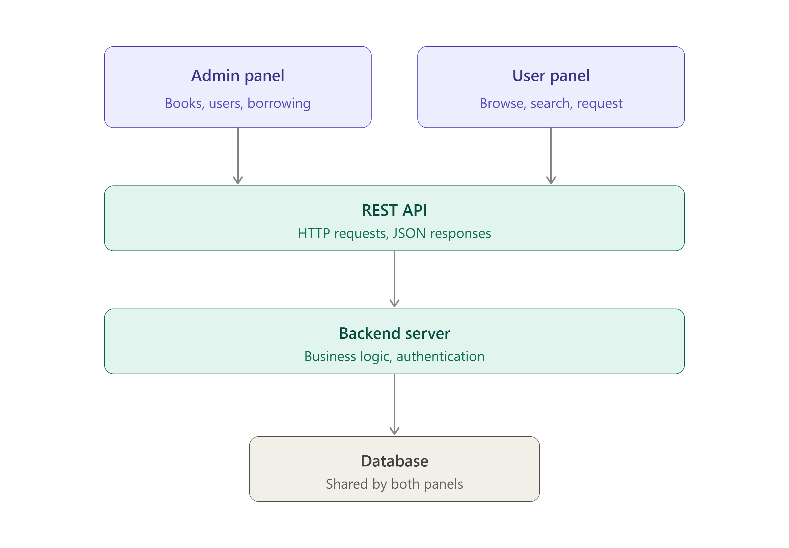

# Library Management System

## Project Overview

The Library Management System is a full-stack system designed to manage books, users, and borrowing records.

The system has two panels:

- Admin Panel
- User Panel

Both panels communicate with a shared backend through APIs and use a common database.

## Project Structure

- admin-frontend: Admin panel
- user-frontend: User panel
- backend: Backend and API
- README.md: Project documentation
- .gitignore: Git ignored files

## Admin Panel

The Admin Panel will allow administrators to manage books, users, and borrowing records.

## User Panel

The User Panel will allow users to browse and search books, check availability, and request books.

## Architecture

Admin Panel and User Panel communicate with the Backend through APIs. The Backend communicates with the shared Database.

## Technologies

This Week 1 assignment focuses on system architecture and Git/GitHub workflow. No working application is required.

